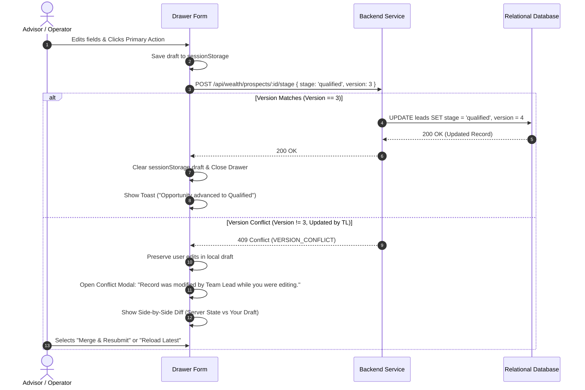

# Master UI/UX Screen & Interaction Flow Specification (Design Flow) — Finverse CRM v2

**Document Status:** Canonical Design Flow Specification  
**Version:** 2.0.0  
**Effective Date:** 2026-10-06  
**Reference Action Deck:** `docs/reference/NEW-Finverse_Wealth_CRM_Premium_UIUX_Action_Deck.pdf` (Pages P006–P035, P313–P315)  
**Component Reference:** `apps/web/src/components/`, `apps/web/src/pages/`  

---

## 1. Unified Workspace Screen Anatomy

Across all ten workspaces and four verticals, every screen adheres to a standardized six-zone architectural anatomy (`[Deck P006-P035]`):

```
┌────────────────────────────────────────────────────────────────────────────────────────┐
│ ZONE 1: Institutional Header Bar (Height: 64px, Sticky Top)                            │
│ [Logo 1:1.22] | Vertical Badge | Employee Avatar & Name | Role Tag | Clock (Asia/Kolkata)│
├───────────────────┬────────────────────────────────────────────────────────────────────┤
│ ZONE 2:           │ ZONE 3: Summary KPI Metric Ribbon (4 Standardized KPI Cards)       │
│ Navigation        ├────────────────────────────────────────────────────────────────────┤
│ Sidebar           │ ZONE 4: Filter & View Bar (Saved Views, Stage, Source, Date Pickers│
│ (Width: 260px,    ├────────────────────────────────────────────────────────────────────┤
│ Role-specific     │ ZONE 5: Primary Working Canvas (Data Grid / Columnar Pipeline)     │
│ Modules Only)     │                                                                    │
│                   │                                                                    │
├───────────────────┴────────────────────────────────────────────────────────────────────┤
│ ZONE 6: Slide-Over Inspection Drawer / Sticky Action Footer                            │
│ (Width: 480px, Slides from Right with Overlay Backdrop)                                │
└────────────────────────────────────────────────────────────────────────────────────────┘
```

### 1.1 Zone Behavioral Specifications

1. **Zone 1: Institutional Header Bar (`Header`):**
   - Renders the original `finverse-logo.png` (unrecolored, preserved 1:1.22 proportion).
   - Displays the current active vertical pill (e.g., `Wealth Management`, `Commercial Banking`).
   - Displays the active employee persona with their authorized role badge (`SC`, `TL`, `MG`, `RM`, `NM`, `CEO`, `CFO`, `DE`, `HR`, `SA`).
   - Digital clock pinned to `Asia/Kolkata` (IST) with day-of-week and date.
2. **Zone 2: Navigation Sidebar (`Sidebar`):**
   - Width: Fixed at `260px`, height `calc(100vh - 64px)`, sticky.
   - Strictly renders only authorized modules for the active role.
   - Active route highlighted in `#113F3D` with a subtle `#6FA8A2` (Mint Accent) left border indicator.
3. **Zone 3: Summary KPI Metric Ribbon (`MetricRibbon`):**
   - Four responsive cards:
     - Card 1: Target Attainment / Revenue Velocity (Numerator / Denominator).
     - Card 2: Conversion / Pacing Rate (with % delta vs prior period).
     - Card 3: Active Pipeline Volume / Backlog.
     - Card 4: Governance / SLA Compliance Breaches (Red tag if $>0$).
4. **Zone 4: Filter & View Bar (`FilterBar`):**
   - Left side: Saved Views dropdown (`caller_saved_views`), Stage multiselect, Source channel filter.
   - Right side: Date Range picker (Defaults: Today, This Week Mon-Sun, This Month MTD, Fiscal QTD), Search input with debounce (300ms).
5. **Zone 5: Primary Working Canvas (`WorkingCanvas`):**
   - Data table with zebra striping or stage-column kanban board.
   - Column headers with instant sorting (`ASC` / `DESC`). Numerical columns right-aligned in `JetBrains Mono`.
   - Row click slides open Zone 6 (Detail Drawer) while preserving active row highlight.
6. **Zone 6: Slide-Over Detail Drawer (`DrawerPanel`):**
   - Width: `480px` on desktop, `100vw` on mobile screens.
   - Houses entity timeline, attached KYC evidence, task history, and decision forms.
   - Sticky footer houses exactly **ONE** solid `#113F3D` primary action button.

### 1.3 Visual Grounding, Reusable Component Foundations & Traceability Standard

1. **Foundational Component Reuse:**
   - All presentation logic builds directly upon the proven component suite in `apps/web/src/components/ui/` (`card`, `badge`, `button`, `input`, `select`, `panel`, `states`, `drawer`, `tabs`) and `WorkspaceShell`.
   - Workspaces across all 4 verticals (`wealth`, `banking`, `markets`, `real-estate`) share the same core design system tokens (Deep Forest `#113F3D`, Mint Accent `#6FA8A2`, Crisp White/Light Gray backgrounds, Manrope/Inter/JetBrains Mono typography).
   - Builders must **never** fork or duplicate entire page suites; pages must be adapted through parameterized vertical context, typed props, and dynamic route configuration.

2. **Visual Inspection Requirement (PDF Grounding):**
   - Before authoring or styling any vertical screen, developers must retrieve the corresponding Graphify action node and **visually inspect the original Action Deck PDF page** (`docs/reference/NEW-Finverse_Wealth_CRM_Premium_UIUX_Action_Deck.pdf`).
   - Designers and builders must preserve the PDF's authentic field labels, visual hierarchy, card arrangements, input controls, empty states, and micro-interactions. Graphify knowledge summaries guide scope but **never** replace visual inspection of the source PDF.

3. **Mandatory Action Traceability:**
   - Every role, view, and action implementation must maintain end-to-end traceability:
     `Action Deck page → detailed requirements & visual reference → existing reusable implementation → vertical-specific differences → verification evidence → remaining gaps`.

---

## 2. Micro-Interactions & State Transition Flows

### 2.1 The Single Primary Action Button Flow
In strict accordance with the Single Solid Primary Button Rule (`[Deck P004, P315]`):
- **Initial Form Render:** The primary action button (e.g., *Schedule Follow-up*, *Approve Conversion*, *Freeze Reconciliation*) renders in solid `#113F3D` with white text.
- **In-Flight / Submitting State:** Clicking transforms the button into a loading state:
  - Cursor changes to `wait`.
  - Button text changes to *"Submitting..."* or *"Recording Fact..."*.
  - An inline SVG spinner replaces the left icon.
  - Button is disabled (`pointer-events: none`) to prevent duplicate double-click mutations.
- **Successful Commit:** Button momentarily renders green checkmark (`#0D9488`) before drawer smoothly auto-closes and updates the table row with optimistic data.
- **Validation Failure:** Button restores active state, drawer remains open, and the offending input field highlights in `#DC2626` with an inline error message.

### 2.2 Optimistic Feedback with Concurrency Recovery


---

## 3. Desktop vs Mobile Ergonomic Flows (`[Deck P313]`)

Finverse CRM v2 provides specialized, ergonomic task surfaces tailored to mobile screen constraints:

```
┌────────────────────────────────────────┐ ┌────────────────────────────────────────┐
│ MOBILE FLOW 1: CALLER TASK WORKSPACE   │ │ MOBILE FLOW 2: LEADERSHIP APPROVAL     │
│ (Viewport: 375px - 412px)              │ │ (Viewport: 375px - 412px)              │
├────────────────────────────────────────┤ ├────────────────────────────────────────┤
│ [Logo] Today's Overdue Tasks (3)       │ │ [Logo] Pending Conversion Approvals (2)│
├────────────────────────────────────────┤ ├────────────────────────────────────────┤
│ ┌────────────────────────────────────┐ │ │ ┌────────────────────────────────────┐ │
│ │ Prospect: Rajesh Mehta             │ │ │ │ Opportunity: FV-1042 (₹75,00,000)  │ │
│ │ Due: 10:30 AM (25m Overdue)        │ │ │ │ Caller: Asha Rao (Team Alpha)      │ │
│ │ Product: Wealth Advisory PMS       │ │ │ │ Evidence: Mandate Signed & CKYC OK │ │
│ │ [ Call Now: +91 98*** ] (Green Btn)│ │ │ │ [ Inspect Documents (PDF) ]       │ │
│ └────────────────────────────────────┘ │ │ └────────────────────────────────────┘ │
├────────────────────────────────────────┤ ├────────────────────────────────────────┤
│ BOTTOM SHEET (Auto-pops on Call End):  │ │ FIXED BOTTOM THUMB BAR:                │
│ Wrap-Up Disposition:                   │ │                                        │
│ ( ) Connected - Follow-up Needed       │ │  ┌───────────────┐  ┌───────────────┐  │
│ ( ) Connected - Send Proposal          │ │  │ Return (Ghost)│  │ Approve Solid │  │
│ ( ) No Answer / Busy                   │ │  │               │  │  (#113F3D)    │  │
│ [ Submit Disposition ] (Solid Primary) │ │  └───────────────┘  └───────────────┘  │
└────────────────────────────────────────┘ └────────────────────────────────────────┘
```

### 3.1 Mobile Caller Execution Flow
1. **Compact Queue Cards:** In place of multi-column data tables, leads are stacked as compact cards prioritized by overdue urgency.
2. **One-Tap Telephony:** Tap on the green call button triggers the native mobile dialer or WebRTC audio bridge.
3. **Automatic Bottom Sheet Disposition:** Upon call termination, a responsive bottom sheet slides up covering the bottom 60% of the screen. The caller selects disposition, schedules follow-up time, and taps the single primary button to commit. Zero typing required for standard wrap-ups.

### 3.2 Mobile Leadership Approval Flow
1. **Card-Based Decision Decks:** Team Leads and Managers reviewing conversions or transfer requests view focused decision cards.
2. **Document Viewer:** Tapping document attachments opens full-screen evidence preview.
3. **Ergonomic Bottom Action Bar:** The two primary thumb actions are pinned to the bottom:
   - Left: *Return with Feedback* (Outline/Ghost button, opens quick feedback note modal).
   - Right: *Approve Conversion* (Solid `#113F3D` primary button, executes one-tap approval).

---

## 4. Modal Dialogs, Empty States, and Error Recovery UX

### 4.1 Modal Dialog Standards
- **Backdrop:** 40% opacity black (`rgba(0, 0, 0, 0.4)`), background blur `2px`.
- **Keyboard Navigation:** `Escape` key closes dialog (with unsaved changes prompt if form is dirty); `Enter` key triggers primary action only on non-destructive single-input prompts.
- **Destructive Confirmations:** Marked with soft red styling (`#FEE2E2` icon backdrop, `#DC2626` text) requiring explicit reason entry before enabling confirmation.

### 4.2 Standard Empty State UX
Empty states never display generic blank space. They provide clear explanations and immediate recovery actions:
- **Empty Pipeline:** *"You have no leads in stage 'Discovery'. Check your unassigned inbox or create a self-sourced enquiry."* `[+ Create Enquiry Button]`
- **Filter Mismatch:** *"0 records match your current filters (Stage: 'Qualified', Source: 'Partner Walk-in')."* `[Clear All Filters Button]`
- **No Approvals Pending:** *"All conversion proposals are reviewed. You're completely up to date!"*

### 4.3 Offline & Network Error Recovery
- If the browser loses network connectivity, an amber banner appears: *"Network connection lost. Offline draft mode active. Changes will sync when reconnected."*
- Form inputs remain interactive and cache mutations in local browser storage. When connection restores, the client synchronizes pending drafts with the API.
