# Master Application State & Flow Specification (App Flow) — Finverse CRM v2

**Document Status:** Canonical Flow Specification  
**Version:** 2.0.0  
**Effective Date:** 2026-10-06  
**Reference Action Deck:** `docs/reference/NEW-Finverse_Wealth_CRM_Premium_UIUX_Action_Deck.pdf` (Pages P003–P005, P314–P317)  
**Product Action Catalogue:** `docs/product/action_catalogue_v2.json`  

---

## 1. Authentication & Workspace Resolution Flow

Finverse CRM v2 strictly rejects client-side role switching, user impersonation, or omni-access menus (`[Deck P003, P314]`):

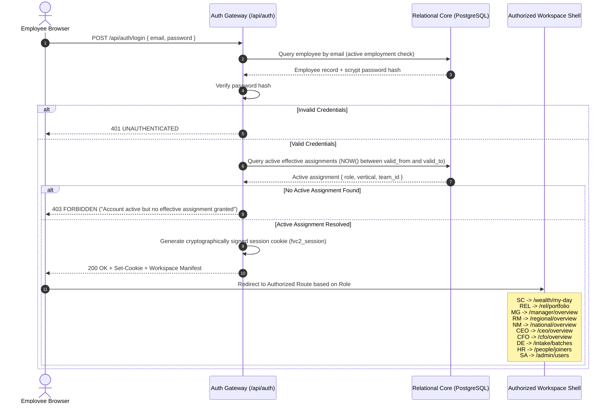

### 1.1 HR Joiner Onboarding & Super Admin Account Activation Flow

```mermaid
sequenceDiagram
    autonumber
    actor HR as Human Resources (HR)
    actor SA as Super Admin (SA)
    actor Emp as New Employee
    participant API as Finverse API
    participant DB as PostgreSQL 16
    participant UI as Workspace UI

    HR->>API: POST /api/hr/onboarding/submit { fullName, primaryMobile, whatsappNumber, email }
    Note over HR,API: HR does not enter password or employee ID
    API->>DB: Check unique email & primary mobile
    alt Duplicate Identity
        API-->>HR: 409 CONFLICT (Duplicate Identity)
    else Unique Validated
        API->>DB: SELECT generate_next_employee_id()
        API->>DB: INSERT INTO employees (id, status='pending_approval', must_change_password=true, ...)
        API->>DB: INSERT INTO hr_lifecycle_requests (id, status='submitted', ...)
        API-->>HR: 201 Created { employeeId: "EMP-xxx", status: "Pending Super Admin Approval" }
    end

    Note over Emp: Pending candidate cannot log in (401 UNAUTHENTICATED) and receives zero leads

    SA->>API: GET /api/superadmin/onboarding/requests
    API-->>SA: List of pending candidates with full audit trail

    SA->>API: POST /api/superadmin/onboarding/approve { requestId, role, vertical, teamId, reportingManagerId, username }
    API->>DB: Validate team and manager belong to vertical; validate manager eligibility
    API->>API: Generate secure one-time temporary password (e.g. Tmp#...!)
    API->>DB: UPDATE employees SET status='active', username=..., password_hash=scrypt(...)
    API->>DB: INSERT INTO assignments (role, vertical, team_id, effective_from=CURRENT_DATE, ...)
    API->>DB: UPDATE hr_lifecycle_requests SET status='activated_by_admin'
    API-->>SA: 200 OK { username, temporaryPassword, ... }
    Note over SA: One-time temporary password displayed once in secure dialog

    Emp->>API: POST /api/auth/login { email: username, password: temporaryPassword }
    API-->>Emp: 200 OK { session: { mustChangePassword: true } }
    UI-->>Emp: Force Initial Login: Password Change Required Modal
    Emp->>API: POST /api/auth/change-password { newPassword }
    API->>DB: UPDATE employees SET password_hash=scrypt(newPassword), must_change_password=false
    API-->>Emp: 200 OK
    UI-->>Emp: Unlock authorized role workspace (/wealth/dashboard)
    Note over Emp: Sales Caller is now active and eligible for round-robin leads in assigned team
```

### 1.2 Universal Password Recovery Flow (`/login` -> Forgot Password)

1. **Self-Service Request:**
   - Any active CRM employee across all roles and verticals can click "Forgot password?" on `/login`.
   - The user enters their registered work email or username.
   - **Neutral Response:** The system always returns `"If an active account matches the details provided, a password reset link has been dispatched to the registered address."` whether or not the account exists, strictly preventing account enumeration attacks.
2. **Cryptographic Token & Outbox:**
   - If an active employee matches, the server generates a cryptographically secure 32-byte random token (`randomBytes(32)`).
   - Only its SHA-256 hash is stored in `account_recovery_requests` with a 1-hour expiration timestamp.
   - The reset link (`/reset-password?token=...`) is written to `local_delivery_outbox` with channel label `Local Delivery Adapter (Demo: No External Email Service)`.
3. **Atomic Consumption & Session Revocation:**
   - When the employee submits their new password via `/reset-password?token=...`:
     * The token is checked against `account_recovery_requests` (verified pending, not expired, matching hash).
     * The target employee must have `status: 'active'` (pending, rejected, disabled, or offboarded employees fail with 422 `ACCOUNT_INACTIVE`).
     * The employee's password hash is atomically replaced with a new scrypt hash, and `must_change_password` is set to `false`.
     * The recovery token and outbox record are marked consumed (`status: 'completed'`).
     * All existing sessions for that employee are revoked (`DELETE FROM sessions WHERE employee_id = ...`).
     * Subsequent attempts to reuse the token fail with 422 `TOKEN_ALREADY_USED`.

---

## 2. Master Lead Lifecycle State Machine

The core lead lifecycle governs prospect movement from raw intake through qualification, conversion, loss, and formal reopening (`[Deck P316]`):

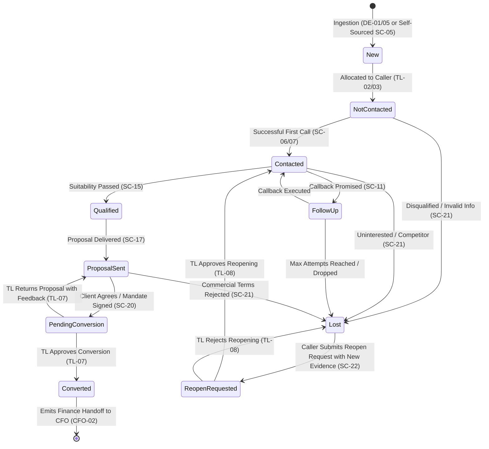

### 2.1 State Transition Invariants
- **Activity vs State:** Phone calls, WhatsApp messages, and meetings are recorded as timeline *activities*. They do not advance pipeline stages unless accompanied by verified stage evidence.
- **Conversion Gate:** A lead cannot enter `pending_conversion` without uploaded client evidence (`SC-19`) and a valid proposal record (`SC-17`).
- **Audit Immutability:** When marked `lost`, the lead enters a terminal read-only state. Reopening requires a fresh justification and explicit Team Lead adjudication (`TL-08`).

### 2.2 Multi-Vertical Pipeline State Machines & Reusable Flow Architecture

Finverse CRM v2 executes a unified workflow engine across four vertical divisions, preserving shared infrastructure while respecting domain-specific state transitions (`[Deck P005]`):

1. **Commercial Banking Lifecycle (Deck P005, P036):**
   - Sequential Progression: `New` $\to$ `Eligibility` $\to$ `Documents` $\to$ `Sanction` $\to$ `Disbursal` (terminal won) or `Lost`.
   - Gate Preconditions: Moving to `Documents` requires verified financial documentation request; moving to `Sanction` requires completed credit assessment; moving to `Disbursal` requires TL conversion approval of sanction letter terms.
   - Banking Loss Adjudication: Accepts domain-specific rejection codes (`Credit rejected`, `CIBIL / score below threshold`, `Insufficient collateral`, `Pricing / interest rate`).

2. **Markets & Securities Lifecycle (Deck P005):**
   - Sequential Progression: `New` $\to$ `KYC` $\to$ `RiskProfiling` $\to$ `DematTradingOpened` $\to$ `FundedFirstTrade` (terminal won) or `Lost`.
   - Gate Preconditions: Advancing through KYC requires SEBI-compliant identity and address proofs; Demat opening requires depository participant verification; Funded trade requires ledger-cleared deposit.

3. **Real Estate Advisory Lifecycle (Deck P005):**
   - Sequential Progression: `New` $\to$ `Requirement` $\to$ `SiteVisit` $\to$ `EOI_Booking` $\to$ `Registration` (terminal won) or `Lost`.
   - Gate Preconditions: Advancing to Site Visit requires scheduled location appointment; EOI Booking requires earnest money deposit receipt; Registration requires executed sale agreement.

4. **Reusable Implementation & Traceability Invariant:**
   - **Reuse Foundation First:** Workspaces, communication forms, task schedulers, activity feeds, audit ledgers, and document viewers are shared across all verticals. Do not recreate separate workspace stacks for Banking, Markets, or Real Estate.
   - **Visual Grounding:** Before implementing or modifying any vertical screen, inspect the actual Action Deck PDF page visually. Graph summaries complement but do not substitute for the visual layout, fields, and micro-interactions of the deck.
   - **Traceability Standard:**
     `Action Deck page → detailed requirements & visual reference → existing reusable implementation → vertical-specific differences → verification evidence → remaining gaps`.

---

## 3. Tiered Sales-to-Executive Escalation & Handoff Flows

### 3.1 Frontline to Middle Management (SC → TL → MG)
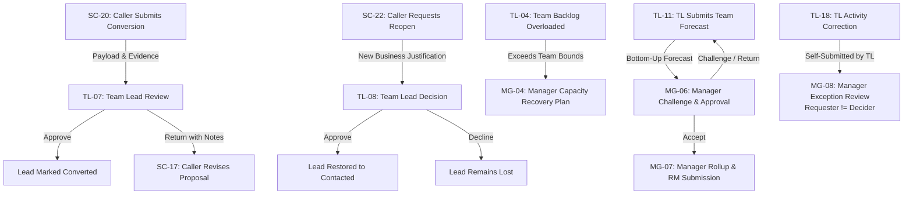

### 3.2 Middle Management to Regional & National Leadership (MG → RM → NM → CEO)
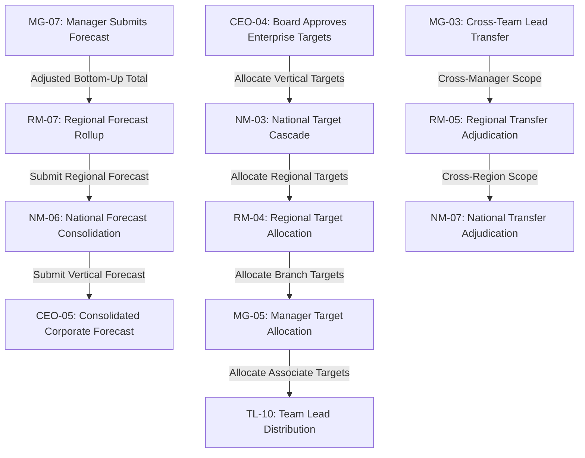

---

## 4. Sales-to-Finance Handover Flow (Frontline → CFO)

The bridge between frontline commercial success and statutory financial truth (`[Deck P026, P227-P240]`):

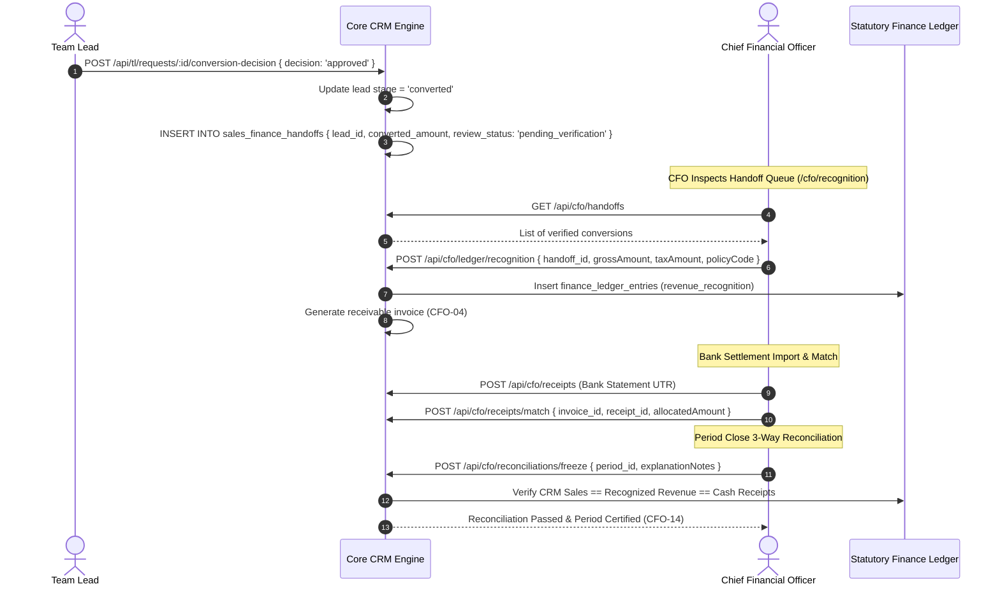

---

## 5. Data Entry Manual Publish & Caller Assignment Flow

The active contract is [Data Entry intake and routing](data-entry-intake-routing.md).
Normal manual form submission publishes immediately. An older staged draft remains
invisible to callers until the operator explicitly publishes it from the saved-records table.

```mermaid
sequenceDiagram
    autonumber
    actor DE as Data Entry Operator
    participant API as Data Entry API
    participant DB as PostgreSQL
    actor SC as Assigned Sales Caller

    DE->>API: POST /api/data-entry/manual-records (vertical, priority, publishImmediately: true)
    API->>API: Validate required fields and vertical grant
    API->>DB: Transaction: insert intake row, allocate eligible caller, insert lead and audit, mark published
    DB-->>API: Committed intake row, lead ID, assigned caller and team
    API-->>DE: Published receipt or explicit routing exception
    DE->>API: GET /api/data-entry/manual-records/:id
    API-->>DE: Persisted publication readback
    SC->>API: GET /api/leads
    API-->>SC: Assigned lead with priority flag; no other caller can read it
```

If no caller is eligible, the transaction records an unassigned routing exception
instead of cross-assigning the prospect. Round-robin grants one caller ownership;
the entire caller team does not receive access to that lead.

---

## 6. People Lifecycle & Access Provisioning Flow (`HR-01..07` → `SA-01..11`)

Employee lifecycle operations maintain complete governance across HR requests, Superadmin provisioning, and operational continuity:

```mermaid
sequenceDiagram
    autonumber
    actor HR as HR Specialist (HR-01..07)
    participant Core as Personnel Directory
    actor SA as Super Administrator (SA-01..11)
    actor Emp as Operational Employee
    participant Ops as Operational Workflows

    HR->>Core: POST /api/hr/joiners { full_name, email, vertical, base_role, join_date } [HR-01]
    Core->>Core: Record employee_profiles (status: 'pending_provisioning')
    Note over SA: SA Inspects Joiner Queue (/admin/users) [SA-01]
    SA->>Core: POST /api/admin/users { employee_id, temp_credentials } [SA-01]
    Core->>Core: Create user account + activation token
    SA->>Core: POST /api/admin/grants { employee_id, role, vertical, team_id, valid_from } [SA-02]
    Core->>Core: Insert effective assignment record
    Emp->>Core: Complete activation & set credentials
    Emp->>Core: Login -> Authorized Workspace opens automatically
    
    opt Personnel Transfer / Promotion / Exit
        HR->>Core: POST /api/hr/lifecycle { employee_id, change_type, effective_date } [HR-02, HR-03]
        SA->>Core: POST /api/admin/assignments/transition [SA-04, SA-05]
        Note over Core,Ops: Historical Ownership Preservation Invariant
        Core->>Ops: Rebalance in-flight open tasks; preserve historical lead events & closed deals
    end
    
    opt Leave & Availability Dampening
        HR->>Core: POST /api/hr/leave { employee_id, leave_type, start_date, end_date } [HR-04]
        Core->>Ops: Suppress caller from TL automated allocation queues for leave duration
    end
```

### 6.1 Invariants for Personnel Governance
1. **Preservation of Historical Record:** When an employee transfers, is promoted, or exits (`HR-02`, `HR-03`, `SA-05`), their historical lead ownership events, call recordings, converted deals, and commission calculations remain immutable.
2. **Effective-Dated Assignment Scoping:** All system grants use `effective_from` and `effective_to` dates. Changes take effect on designated dates without disrupting past audit attribution.
3. **Leave-Aware Allocation:** Approved leave registered in HR (`HR-05`) immediately dampens frontline caller allocation availability in Team Lead workflows.

### 6.2 Multi-Tier Superior Approval Hierarchy (Owner Requirement)
Every employee across all 4 operational verticals (Wealth, Banking, Markets, Real Estate) and shared horizontals must submit leave requests through an upward superior hierarchy:

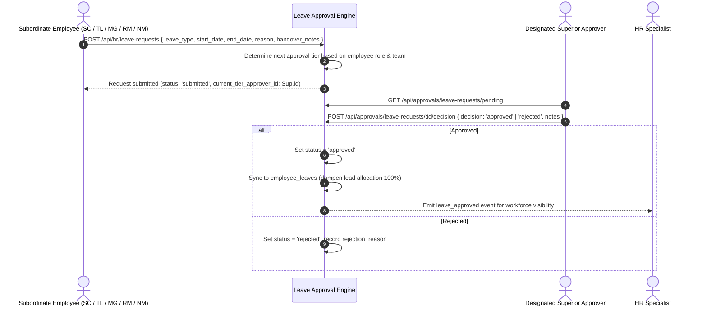

#### Universal Line-of-Command Routing
```
Sales Caller (SC) ──> Team Lead (TL) ──> Manager (MG) ──> Regional Manager (RM) ──> National Manager (NM) ──> Chief Executive Officer (CEO)
```

#### Non-Hierarchical / Governance Approver Configuration
For roles outside the vertical sales line, approvers are explicitly configured via system rules:
| Subordinate Role | Primary Configured Approver | Fallback Approver | Self-Approval Policy |
|---|---|---|---|
| **Data Entry (DE)** | Operations Lead / Intake Head | Super Admin | `422 SELF_APPROVAL_FORBIDDEN` |
| **Human Resources (HR)** | Chief Executive Officer (CEO) | Chief Financial Officer (CFO) | `422 SELF_APPROVAL_FORBIDDEN` |
| **Super Administrator (SA)** | Chief Executive Officer (CEO) | Chief Financial Officer (CFO) | `422 SELF_APPROVAL_FORBIDDEN` |
| **Chief Financial Officer (CFO)** | Chief Executive Officer (CEO) | Board Audit Committee Chair | `422 SELF_APPROVAL_FORBIDDEN` |
| **Chief Executive Officer (CEO)** | Board of Directors / Compensation Chair | Senior Non-Executive Director | `422 SELF_APPROVAL_FORBIDDEN` |

### 6.3 Paid Work-From-Home (WFH) & Attendance Evidence Flow (Owner Requirement)
**Mandatory Invariant:** CRM login or token authentication alone is **strictly NOT attendance**. Attendance requires verified active engagement:

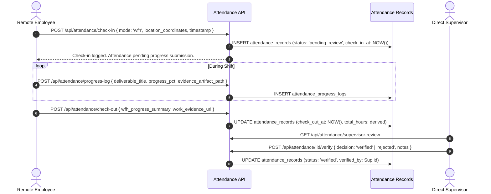

### 6.4 Effective-Dated Compensation & Payroll Calculation Flow (Owner Requirement)
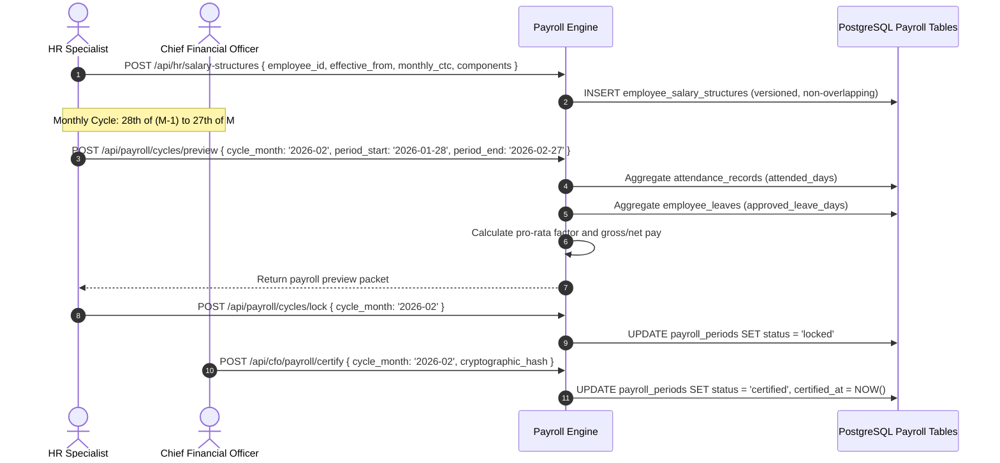

---

## 7. Multi-Vertical Referral Flow (`SC-23` → `NM-08`)

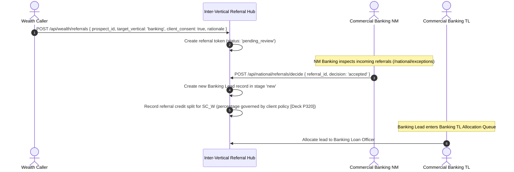

---

## 8. Priority Lead Allocation & Lead Inbox Workflow (Client-Added Requirement)

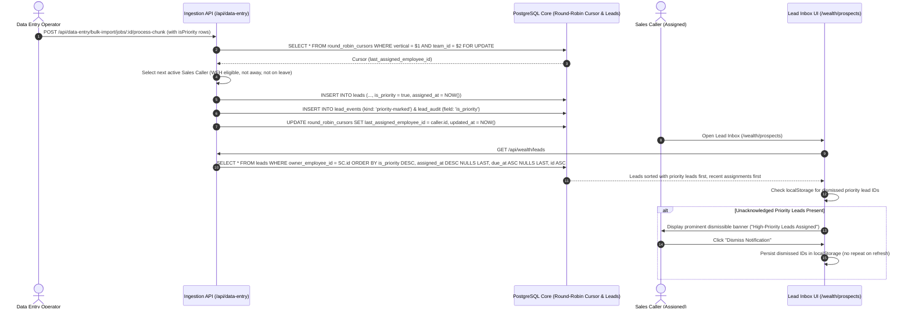

---

## 9. Secure Click-to-Call & Voice Provider Architecture (`SC-06` Preparation)

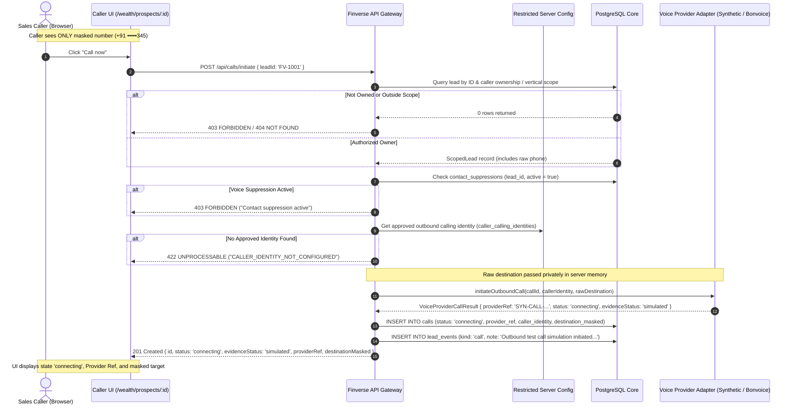


