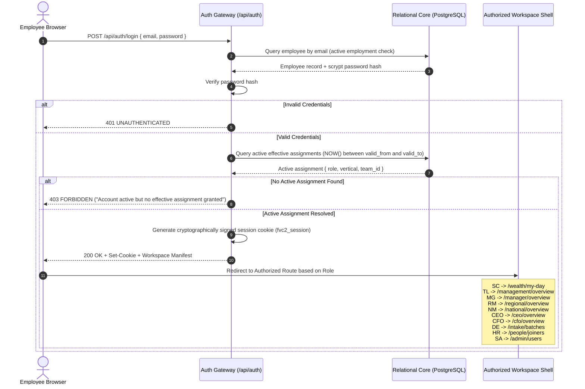
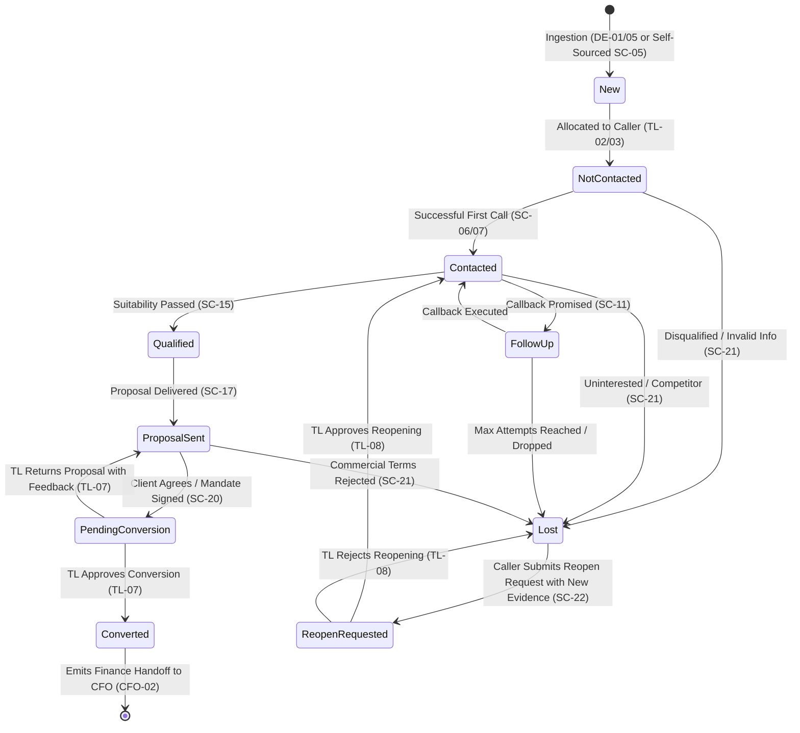
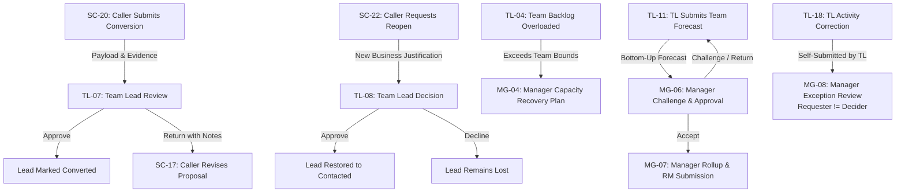
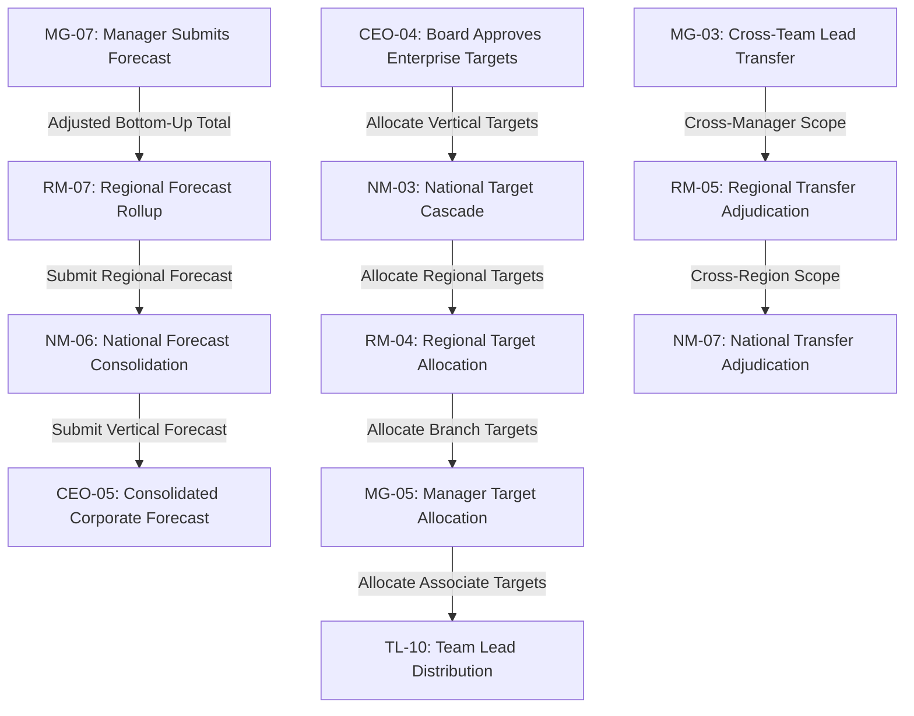
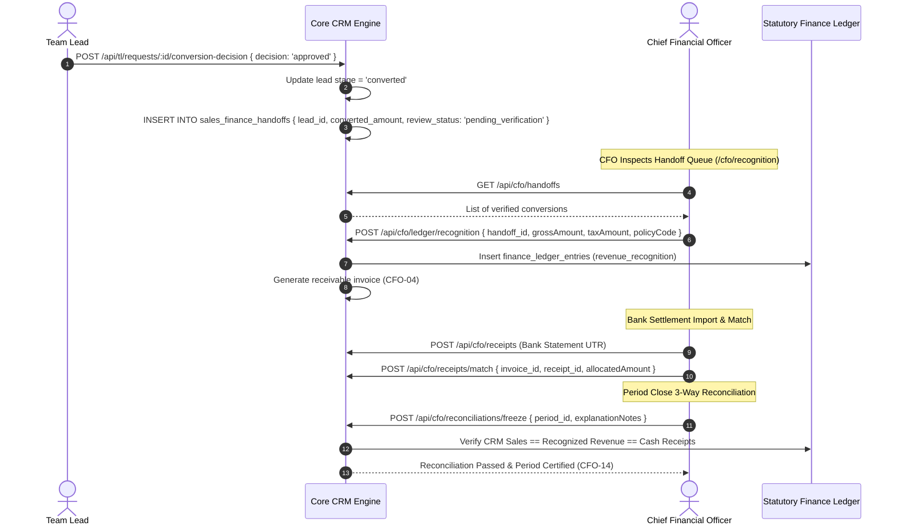
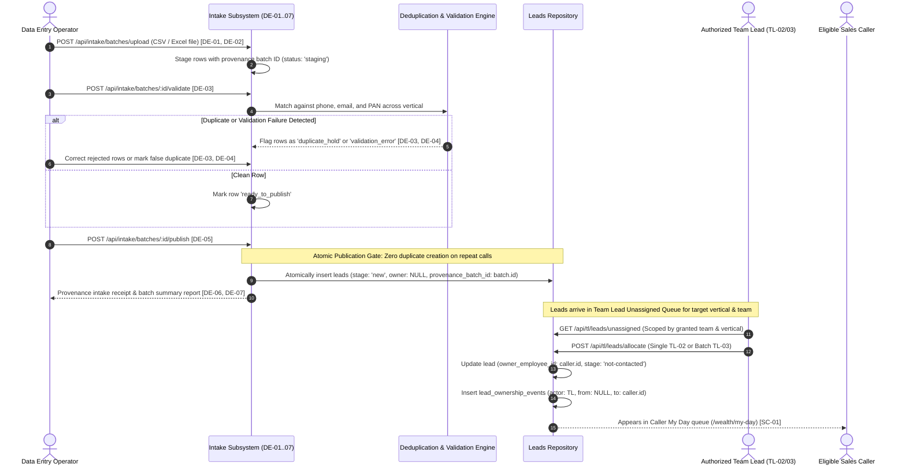
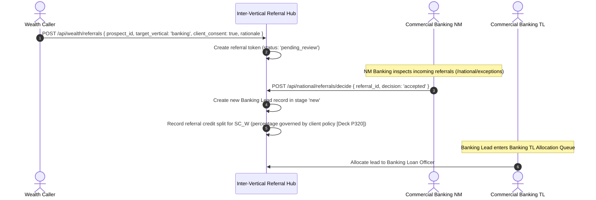

# Master Application State & Flow Specification (App Flow) — Finverse CRM v2

**Document Status:** Canonical Flow Specification  
**Version:** 2.0.0  
**Effective Date:** 2026-10-06  
**Reference Action Deck:** `docs/reference/NEW-Finverse_Wealth_CRM_Premium_UIUX_Action_Deck.pdf` (Pages P003–P005, P314–P317)  
**Product Action Catalogue:** `docs/product/action_catalogue_v2.json`  

---

## 1. Authentication & Workspace Resolution Flow

Finverse CRM v2 strictly rejects client-side role switching, user impersonation, or omni-access menus (`[Deck P003, P314]`):



---

## 2. Master Lead Lifecycle State Machine

The core lead lifecycle governs prospect movement from raw intake through qualification, conversion, loss, and formal reopening (`[Deck P316]`):



### 2.1 State Transition Invariants
- **Activity vs State:** Phone calls, WhatsApp messages, and meetings are recorded as timeline *activities*. They do not advance pipeline stages unless accompanied by verified stage evidence.
- **Conversion Gate:** A lead cannot enter `pending_conversion` without uploaded client evidence (`SC-19`) and a valid proposal record (`SC-17`).
- **Audit Immutability:** When marked `lost`, the lead enters a terminal read-only state. Reopening requires a fresh justification and explicit Team Lead adjudication (`TL-08`).

### 2.2 Multi-Vertical Pipeline State Machines & Reusable Flow Architecture

Finverse CRM v2 executes a unified workflow engine across four vertical divisions, preserving shared infrastructure while respecting domain-specific state transitions (`[Deck P005]`):

1. **Commercial Banking Lifecycle (Deck P005, P036):**
   - Sequential Progression: `New` $\to$ `Eligibility` $\to$ `Documents` $\to$ `Sanction` $\to$ `Disbursal` (terminal won) or `Lost`.
   - Gate Preconditions: Moving to `Documents` requires verified financial documentation request; moving to `Sanction` requires completed credit assessment; moving to `Disbursal` requires TL conversion approval of sanction letter terms.
   - Banking Loss Adjudication: Accepts domain-specific rejection codes (`Credit rejected`, `CIBIL / score below threshold`, `Insufficient collateral`, `Pricing / interest rate`).

2. **Markets & Securities Lifecycle (Deck P005):**
   - Sequential Progression: `New` $\to$ `KYC` $\to$ `RiskProfiling` $\to$ `DematTradingOpened` $\to$ `FundedFirstTrade` (terminal won) or `Lost`.
   - Gate Preconditions: Advancing through KYC requires SEBI-compliant identity and address proofs; Demat opening requires depository participant verification; Funded trade requires ledger-cleared deposit.

3. **Real Estate Advisory Lifecycle (Deck P005):**
   - Sequential Progression: `New` $\to$ `Requirement` $\to$ `SiteVisit` $\to$ `EOI_Booking` $\to$ `Registration` (terminal won) or `Lost`.
   - Gate Preconditions: Advancing to Site Visit requires scheduled location appointment; EOI Booking requires earnest money deposit receipt; Registration requires executed sale agreement.

4. **Reusable Implementation & Traceability Invariant:**
   - **Reuse Foundation First:** Workspaces, communication forms, task schedulers, activity feeds, audit ledgers, and document viewers are shared across all verticals. Do not recreate separate workspace stacks for Banking, Markets, or Real Estate.
   - **Visual Grounding:** Before implementing or modifying any vertical screen, inspect the actual Action Deck PDF page visually. Graph summaries complement but do not substitute for the visual layout, fields, and micro-interactions of the deck.
   - **Traceability Standard:**
     `Action Deck page → detailed requirements & visual reference → existing reusable implementation → vertical-specific differences → verification evidence → remaining gaps`.

---

## 3. Tiered Sales-to-Executive Escalation & Handoff Flows

### 3.1 Frontline to Middle Management (SC → TL → MG)


### 3.2 Middle Management to Regional & National Leadership (MG → RM → NM → CEO)


---

## 4. Sales-to-Finance Handover Flow (Frontline → CFO)

The bridge between frontline commercial success and statutory financial truth (`[Deck P026, P227-P240]`):



---

## 5. Data Entry Intake & Allocation Routing Flow (`DE-01..07` → `TL-02/03`)

The ingestion pipeline enforces strict data provenance, zero arbitrary ownership for Data Entry, and idempotent publication:



### 5.1 Invariants for Data Entry to Team Lead Routing
1. **Zero Lead Ownership for Data Entry:** Data Entry operators never hold ownership of leads (`owner_employee_id` remains `NULL` upon publication).
2. **Canonical Lead Identifiers & Provenance:** Every published lead receives a canonical ID and links immutably to its `intake_batch_id` and raw row receipt.
3. **Idempotent Publication:** Repeated calls to `POST /api/intake/batches/:id/publish` are idempotent; already-published rows are skipped without generating duplicate records.
4. **Traceable Exclusions & Partial Recovery:** Held or rejected rows remain quarantined, excluded from the lead pool, and independently recoverable.
5. **Eligibility Dampening:** Team Lead allocation algorithms (`TL-02`, `TL-03`) automatically respect caller availability, capacity caps (max 20 active), and HR-recorded leave status.

---

## 6. People Lifecycle & Access Provisioning Flow (`HR-01..07` → `SA-01..11`)

Employee lifecycle operations maintain complete governance across HR requests, Superadmin provisioning, and operational continuity:

```mermaid
sequenceDiagram
    autonumber
    actor HR as HR Specialist (HR-01..07)
    participant Core as Personnel Directory
    actor SA as Super Administrator (SA-01..11)
    actor Emp as Operational Employee
    participant Ops as Operational Workflows

    HR->>Core: POST /api/hr/joiners { full_name, email, vertical, base_role, join_date } [HR-01]
    Core->>Core: Record employee_profiles (status: 'pending_provisioning')
    Note over SA: SA Inspects Joiner Queue (/admin/users) [SA-01]
    SA->>Core: POST /api/admin/users { employee_id, temp_credentials } [SA-01]
    Core->>Core: Create user account + activation token
    SA->>Core: POST /api/admin/grants { employee_id, role, vertical, team_id, valid_from } [SA-02]
    Core->>Core: Insert effective assignment record
    Emp->>Core: Complete activation & set credentials
    Emp->>Core: Login -> Authorized Workspace opens automatically
    
    opt Personnel Transfer / Promotion / Exit
        HR->>Core: POST /api/hr/lifecycle { employee_id, change_type, effective_date } [HR-02, HR-03]
        SA->>Core: POST /api/admin/assignments/transition [SA-04, SA-05]
        Note over Core,Ops: Historical Ownership Preservation Invariant
        Core->>Ops: Rebalance in-flight open tasks; preserve historical lead events & closed deals
    end
    
    opt Leave & Availability Dampening
        HR->>Core: POST /api/hr/leave { employee_id, leave_type, start_date, end_date } [HR-04]
        Core->>Ops: Suppress caller from TL automated allocation queues for leave duration
    end
```

### 6.1 Invariants for Personnel Governance
1. **Preservation of Historical Record:** When an employee transfers, is promoted, or exits (`HR-02`, `HR-03`, `SA-05`), their historical lead ownership events, call recordings, converted deals, and commission calculations remain immutable.
2. **Effective-Dated Assignment Scoping:** All system grants use `effective_from` and `effective_to` dates. Changes take effect on designated dates without disrupting past audit attribution.
3. **Leave-Aware Allocation:** Approved leave registered in HR (`HR-04`) immediately dampens frontline caller allocation availability in Team Lead workflows.


---

## 7. Multi-Vertical Referral Flow (`SC-23` → `NM-08`)


